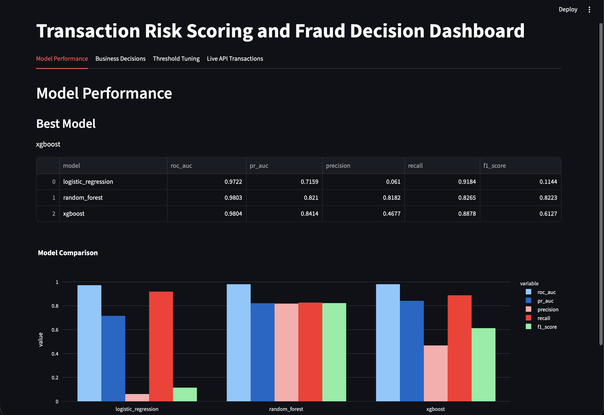
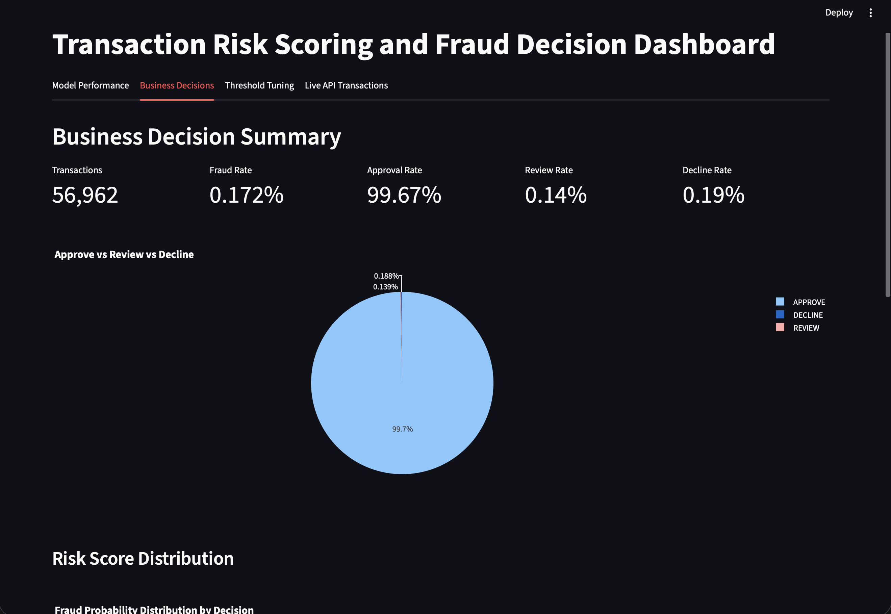
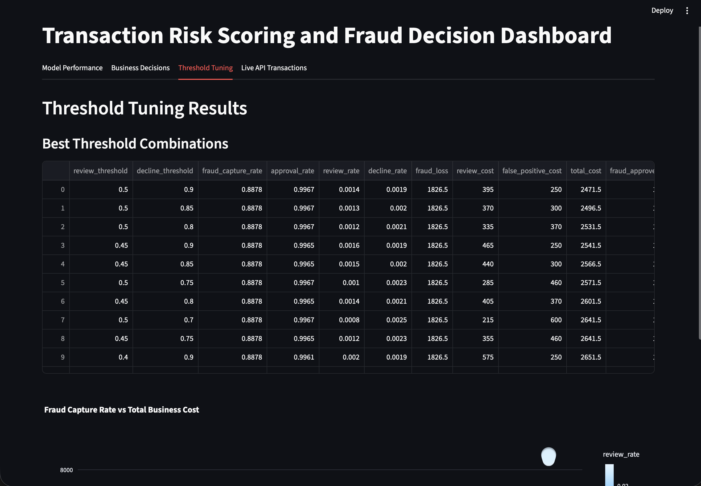
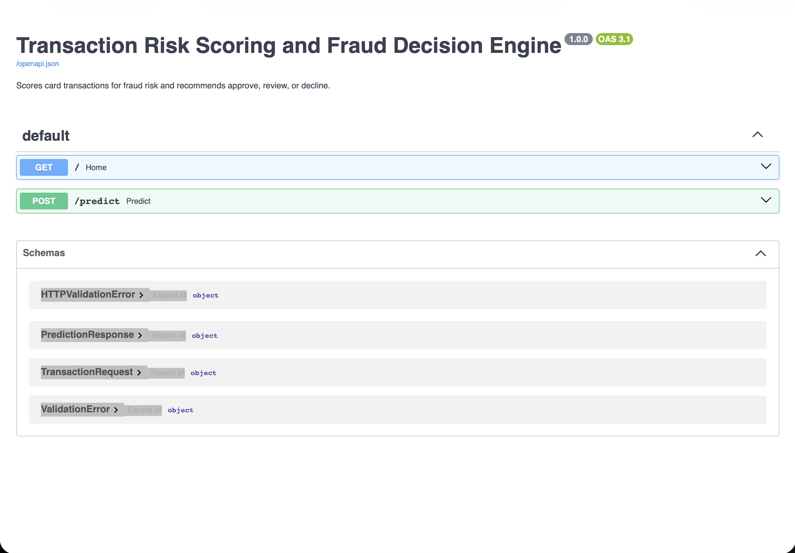

# Transaction Risk Scoring and Fraud Decision Engine

An end-to-end fraud risk scoring system that uses machine learning to score credit card transactions and convert fraud probabilities into business decisions: **Approve**, **Manual Review**, or **Decline**.

This project is designed to go beyond a simple fraud classification notebook. It connects model output with real business risk decisions such as fraud capture, customer friction, manual review volume, false positives, and estimated financial impact.

---

## Project Overview

Financial institutions do not only need to know whether a transaction is fraudulent. They need to decide what action should be taken in real time.

This project answers three practical business questions:

1. Should the transaction be approved?
2. Should the transaction be sent for manual review?
3. Should the transaction be declined or blocked?

The system trains machine learning models on real credit card fraud data, generates fraud probability scores, applies business thresholds, stores scored transactions, and displays decision-level analytics in an interactive dashboard.

---

## Key Features

- Real credit card fraud dataset support
- Exploratory analysis of transaction amount, time, and fraud labels
- Model training using Logistic Regression, Random Forest, and XGBoost
- Class imbalance handling using class weights and XGBoost scale-positive weighting
- Evaluation using ROC-AUC, PR-AUC, precision, recall, F1-score, and confusion matrix
- Business threshold tuning for approve, review, and decline decisions
- Expected fraud loss and customer friction analysis
- FastAPI endpoint for real-time transaction scoring
- SQLite database for storing scored transactions
- Streamlit dashboard for fraud risk monitoring and business analytics

---

## Dataset

This project uses the **Kaggle Credit Card Fraud Detection** dataset.

The dataset contains anonymized credit card transactions made by European cardholders. The features `V1` to `V28` are PCA-transformed for confidentiality. The original interpretable columns available are:

- `Time`
- `Amount`
- `Class`

The target column is:

- `Class = 0`: Genuine transaction
- `Class = 1`: Fraudulent transaction

The dataset is highly imbalanced, which makes it suitable for fraud detection and risk modeling.

Dataset source: Kaggle Credit Card Fraud Detection by ULB Machine Learning Group.

---

## Business Decision Logic

The model produces a fraud probability score between 0 and 1. This score is converted into a business decision using threshold rules.

| Fraud Probability | Risk Band | Decision |
|---:|---|---|
| Below review threshold | Low Risk | Approve |
| Between review and decline thresholds | Medium Risk | Manual Review |
| Above decline threshold | High Risk | Decline |

This allows the project to behave like a real fraud decision engine rather than only a binary ML classifier.

---

## Tech Stack

| Area | Tools |
|---|---|
| Programming | Python |
| Data Processing | Pandas, NumPy |
| Machine Learning | Scikit-learn, XGBoost |
| Model Evaluation | ROC-AUC, PR-AUC, Precision, Recall, F1-score |
| Backend API | FastAPI, Uvicorn |
| Database | SQLite |
| Dashboard | Streamlit, Plotly |
| Model Persistence | Joblib |

---

## Project Structure

```text
Transaction Risk Engine/
│
├── app/
│   ├── __init__.py
│   ├── api.py
│   ├── database.py
│   ├── decision_engine.py
│   └── schemas.py
│
├── dashboard/
│   └── streamlit_app.py
│
├── data/
│   ├── raw/
│   │   └── creditcard.csv
│   └── processed/
│       ├── scored_test_transactions.csv
│       └── threshold_tuning_results.csv
│
├── models/
│   ├── fraud_model.pkl
│   ├── scaler.pkl
│   └── model_metrics.json
│
├── reports/
│   └── figures/
│
├── src/
│   ├── __init__.py
│   ├── config.py
│   ├── data_loader.py
│   ├── evaluate.py
│   ├── threshold_tuning.py
│   └── train.py
│
├── sql/
│   └── schema.sql
│
├── README.md
├── requirements.txt
└── run_project.md
```

---

## Screenshots

Add your screenshots inside the `reports/figures/` folder and use the names below.

### Streamlit Dashboard - Model Performance



### Streamlit Dashboard - Business Decision Summary



### Streamlit Dashboard - Threshold Tuning



### FastAPI Swagger UI




---


## Dashboard

The Streamlit dashboard contains four main sections.

### 1. Model Performance

Shows model comparison across:

- ROC-AUC
- PR-AUC
- Precision
- Recall
- F1-score

### 2. Business Decisions

Shows decision-level monitoring:

- Total transactions
- Fraud rate
- Approval rate
- Review rate
- Decline rate
- Risk score distribution
- Sample scored transactions

### 3. Threshold Tuning

Shows how different threshold combinations affect:

- Fraud capture rate
- Approval rate
- Review rate
- Decline rate
- Total business cost
- False-positive cost
- Manual review cost

### 4. Live API Transactions

Shows transactions scored through the FastAPI endpoint and stored in SQLite.

---

## Machine Learning Workflow

The training pipeline follows this workflow:

1. Load real credit card fraud data.
2. Split the dataset using stratified train-test split.
3. Scale `Time` and `Amount` columns.
4. Train multiple models.
5. Evaluate model performance.
6. Select the best model using PR-AUC.
7. Tune business thresholds.
8. Save model artifacts.
9. Generate scored test transactions.
10. Use the model through FastAPI and Streamlit.

---

## Why PR-AUC Matters Here

The dataset is highly imbalanced, with fraud cases forming a very small percentage of total transactions. In such cases, accuracy can be misleading because a model can predict almost everything as genuine and still appear accurate.

PR-AUC is more useful because it focuses on precision and recall for the minority fraud class.

---

## Business Metrics Used

This project does not only evaluate technical ML metrics. It also tracks business-oriented metrics:

| Metric | Meaning |
|---|---|
| Fraud Capture Rate | Percentage of fraud cases sent to review or declined |
| Approval Rate | Percentage of transactions approved automatically |
| Review Rate | Percentage of transactions sent to manual review |
| Decline Rate | Percentage of transactions blocked |
| False Positives | Genuine transactions incorrectly declined |
| Fraud Loss | Fraud amount lost when fraud is approved |
| Review Cost | Operational cost of reviewing transactions |
| Total Cost | Combined fraud loss, review cost, and false-positive cost |

---

## Results

After training, the final results are saved in:

```text
models/model_metrics.json
data/processed/threshold_tuning_results.csv
data/processed/scored_test_transactions.csv
```


```text
Best Model: xgboost
ROC-AUC: 0.980419626348007
PR-AUC: 0.841364178088326
Best Review Threshold: 0.5
Best Decline Threshold: 0.9
Fraud Capture Rate: 0.8878
Approval Rate: 0.9967
Review Rate: 0.0014
Decline Rate: 0.0019
```
The approval rate is high because the fraud dataset is highly imbalanced, with only about 0.17% fraudulent transactions. Therefore, most transactions are genuine and should be approved. The key performance indicator is fraud capture rate, not approval rate alone. With the selected thresholds, the system approved 99.67% of transactions while still capturing 88.78% of fraud cases through review or decline decisions.


